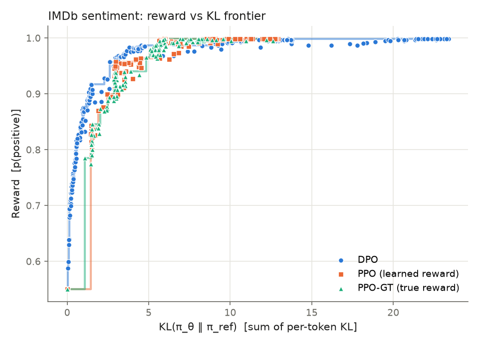
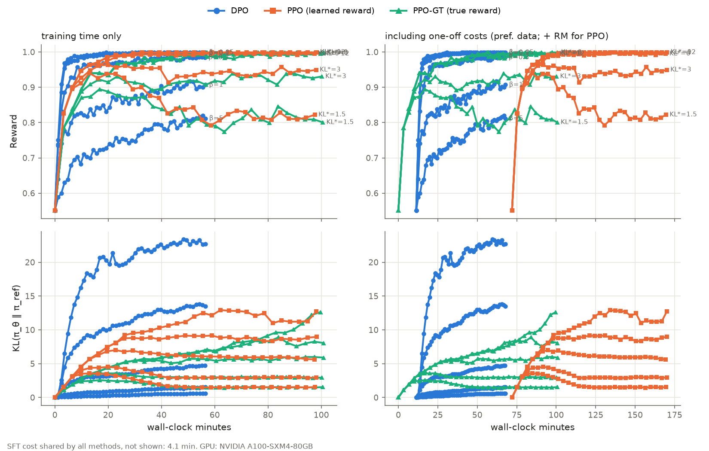

# Replicating DPO vs PPO on IMDb Sentiment, From Scratch

2026-11-07 · Nate Chen

## TL;DR

We rebuilt the DPO paper's IMDb sentiment experiment from scratch (Rafailov et al. 2023, Sec 6.1, Fig 2 left). DPO beat both PPO variants at every KL budget up to 5. That held against a PPO we tuned more carefully than the paper's.

- **Low KL is where DPO wins clearly.** At KL ≤ 1.5, DPO reaches reward 0.917. PPO reaches 0.843, and PPO trained on the true reward reaches 0.827. The gap is 4–5 standard errors of the evaluation.
- **Our PPO is far stronger than the paper's.** It reaches 0.97 by KL 5, while the paper's PPO is around 0.85–0.9 at KL 10–12. The DPO win is against a tuned baseline.
- **Above KL ≈ 6, all methods sit at reward ≥ 0.986.** PPO edges DPO by 0.013 at KL 6–9, in a KL range where no DPO run settles.
- **DPO is much cheaper.** At β ≤ 0.3 it reaches reward 0.9 in 2.4–4.8 minutes of training. PPO needs 6.6–9.8 minutes, plus 72 minutes of one-off setup for preference data and a reward model.
- **Main caveats:**
   - Each configuration was trained once.
   - Three of the 15 runs were added after we saw the first results.
   - KL stands in for text quality; we never read samples.
   - This is a 774M model on a toy task.

## Experiment setup

We followed the paper wherever it gives a value: Sec 6.1, App B and App C.1. Everything it leaves open is our choice, and each choice is logged in a deviations file in the repo.

**Task.** The prompt is the first 2–8 tokens of an IMDb review. The policy must continue it with positive sentiment. Reward is p(positive) from `siebert/sentiment-roberta-large-english`, the paper's classifier.

**Pipeline**

1. **SFT:** `gpt2-large` was fine-tuned on 20,000 IMDb-train reviews for 1 epoch.
   - Reviews were truncated to 128 tokens.
   - Optimizer: AdamW, lr 1e-5, batch 32.
   - The result is π_SFT. It is the reference policy and the starting point for every run.
2. **Preference data:** 25,000 IMDb-train prefixes, with 4 samples each from π_SFT.
   - Sampling used temperature 1.0 and at most 48 new tokens.
   - The classifier ranked all 6 pairs per prefix, giving about 150k pairs.
3. **Reward model:** `gpt2-large` with a scalar head, trained 3 epochs on those pairs.
   - 5% of prefixes were held out, and we kept the best validation checkpoint.
   - Validation accuracy: 85.9%.
4. **Policies:** the three methods in the table below. Each one was swept over its conservativeness setting.

| Method | Trained on | Sweep (paper) | Fill-in | Other settings |
| --- | --- | --- | --- | --- |
| DPO | preference pairs | β ∈ {0.05, 0.1, 1, 5} | β = 0.3 | RMSprop, lr 1e-6, 150-step warmup, batch 64 (paper); 2 epochs = 4,686 steps |
| PPO | learned reward model | target KL ∈ {3, 6, 9, 12} | target 1.5 | 1,024 rollouts per step, 150 steps (153,600 rollouts) |
| PPO-GT | classifier p(positive) | target KL ∈ {3, 6, 9, 12} | target 1.5 | same as PPO |

**PPO details** (the paper gives only the target-KL sweep and the 1,024 rollouts per step):

- Updates: 4 epochs per step, minibatch 64, clip 0.2, value clip 0.2, value coefficient 0.1.
- Advantages: GAE with γ = 1 and λ = 0.95.
- KL penalty: per token, set by an adaptive KL controller (Ziegler et al.) starting at 0.2 with horizon 10,000.
- Rewards: whitened within each rollout batch. That is our reading of the paper's "normalized rewards".

**PPO learning rate.** We tuned it before the main sweep:

- **Runs:** PPO-GT at target KL 6, 50 steps each.
- **Selection data:** 512 prompts from IMDb's unlabeled split, kept apart from the test prompts.
- **Result:** lr 3e-6 gave the best reward at KL ≤ 6: 0.932, against 0.914 for 1e-6 and 0.853 for 1e-5.

Both PPO variants use lr 3e-6. DPO uses the paper's hyperparameters without tuning.

**Evaluation**

- **Prompts:** 512 fixed IMDb-test prefixes. Every eval of every run reuses the same sampling seed, so checkpoint-to-checkpoint noise partly cancels.
- **Reward:** mean p(positive) over the 512 completions.
- **KL:** exact per-token KL over the full vocabulary, summed over completion tokens, at contexts sampled from the policy (paper footnote 3).
- **Schedule:** every 100 DPO steps (6,400 pairs) and every 5 PPO steps (5,120 rollouts). There is no early stopping; every run has a fixed budget.
- **Frontier:** for each KL budget, the best reward among all of a method's checkpoints within that budget. This envelope summarizes the paper's scatter of every checkpoint.

**Compute and implementation**

- **Hardware:** one A100-SXM4-80GB on RunPod. Policy weights train in bf16 autocast over fp32 master weights; dropout is off for policy and reference. The whole pipeline took 26.4 GPU-hours.
- **Code:** everything is our own PyTorch, including the sampler, DPO, the Bradley–Terry reward model, PPO and the KL evaluation. Hugging Face libraries only load weights, tokenizers and IMDb. We used no TRL and did not consult the authors' code.
- **Tests:** 40 unit tests, one of which checks our DPO loss against the paper's App B code.

**Departures from the paper that affect comparison**

- **Dropped baselines:** Unlikelihood, Preferred-FT and TRL's PPO-GT.
- **PPO tuning:** PPO received the learning-rate tuning described above.
- **Fill-in runs:** three runs were added off the paper's grid after the main sweep; see Results.
- **Seeds:** one per configuration, as the paper appears to use.

## Results

DPO's frontier lies above both PPO variants at every KL budget up to 5. Above KL 6, every method is at reward ≥ 0.986. π_SFT scores 0.551.

### Reward–KL frontier

| KL budget | DPO | PPO | PPO-GT | DPO minus best PPO |
| --- | --- | --- | --- | --- |
| ≤ 1 | **0.876** | 0.551 | 0.551 | +0.325 (PPO has no checkpoint here) |
| ≤ 1.5 | **0.917** | 0.843 | 0.827 | +0.074 |
| ≤ 2 | **0.917** | 0.870 | 0.846 | +0.047 |
| ≤ 3 | **0.964** | 0.958 | 0.939 | +0.006 |
| ≤ 5 | **0.986** | 0.964 | 0.966 | +0.020 |
| ≤ 8 | 0.986 | **0.999** | **0.999** | −0.013 |
| ≤ 15 | 0.999 | 0.999 | 0.999 | 0.000 |

Each cell is the best reward among that method's checkpoints with KL within the budget. One eval's standard error is about 0.017 at reward 0.8–0.9 and 0.002–0.005 near 0.99.

At KL ≤ 1 the gap reflects coverage, not training quality. PPO's first checkpoint after step 0 already sits at KL 1.09 (PPO-GT) or 1.53 (PPO).



*Every evaluation checkpoint of all 15 runs, with each method's frontier drawn as a step line. The figure does not distinguish the three fill-in runs from the rest.*

**The paper's two claims**

| Claim | Our result |
| --- | --- |
| DPO's reward–KL frontier dominates PPO's | Holds for KL ≤ 5. At KL 6–9 PPO leads by 0.013, about 3 SE, a range where no DPO run settles. Above that, all methods tie at ≈0.999 |
| DPO beats PPO even when PPO has the ground-truth reward | Holds for KL ≤ 5, by a wider margin than over PPO with the learned reward |

**Against the paper's figure** (read off Fig 2):

- **DPO:** the paper reaches about 0.9 at KL 1–2 and 0.95–1.0 at KL 3–5. We match it: 0.917 at KL ≤ 2, and 0.964–0.986 at KL 3–5.
- **PPO:** the paper's PPO and PPO-GT reach about 0.85–0.9 only around KL 10–12. Ours reach 0.964–0.966 by KL 5 and 0.999 by KL 8.

### Where each run ended

| Run | Setting | Final KL | Final reward | Best reward |
| --- | --- | --- | --- | --- |
| DPO | β = 5 | 0.61 | 0.812 | 0.820 |
| DPO | β = 1 | 1.53 | 0.907 | 0.917 |
| DPO (fill-in) | β = 0.3 | 4.76 | 0.985 | 0.986 |
| DPO | β = 0.1 | 13.48 | 0.997 | 0.999 |
| DPO | β = 0.05 | 22.69 | 0.999 | 0.999 |
| PPO (fill-in) | target 1.5 | 1.55 | 0.822 | 0.940 |
| PPO | target 3 | 2.96 | 0.949 | 0.964 |
| PPO | target 6 | 5.63 | 0.995 | 0.999 |
| PPO | target 9 | 8.96 | 0.999 | 0.999 |
| PPO | target 12 | 12.75 | 0.999 | 0.999 |
| PPO-GT (fill-in) | target 1.5 | 1.54 | 0.801 | 0.894 |
| PPO-GT | target 3 | 2.95 | 0.931 | 0.939 |
| PPO-GT | target 6 | 5.90 | 0.997 | 0.999 |
| PPO-GT | target 9 | 8.06 | 0.999 | 0.999 |
| PPO-GT | target 12 | 12.63 | 0.995 | 0.999 |

Every PPO run finished within 1.0 of its target KL. For PPO at targets 1.5 and 3, the best reward came from an early checkpoint that overshot the target before the controller pulled KL back down.

### The fill-in runs changed the verdict at KL 2–5

The paper's grid left gaps. No DPO β settled between KL 1.5 and 13.5, and no PPO target sat below KL 3.

On the main sweep alone, PPO led at KL ≤ 3: 0.958 against DPO's 0.917. That lead came from PPO's target-3 run, which settles there; DPO only had checkpoints passing through. The fill-ins (DPO β = 0.3 and PPO / PPO-GT at target 1.5) added a run settling in each other's winning range. With them:

- DPO at KL ≤ 3 rose to 0.964.
- PPO at KL ≤ 1.5 rose only to 0.843.

### Compute and training time

DPO at β ≤ 0.3 reaches reward 0.9 1.4–4 times faster than PPO in training time. Counting one-off costs, it is about five times faster than PPO with a learned reward.

| Run | To 0.9, training only | To 0.9, with one-off costs | To 0.95, with one-off costs |
| --- | --- | --- | --- |
| DPO β = 0.05 | 145 s | 824 s | 896 s |
| DPO β = 0.1 | 218 s | 896 s | 896 s |
| DPO β = 0.3 | 289 s | 967 s | 1,183 s |
| DPO β = 1 | 2,389 s | 3,068 s | never |
| PPO, targets 3–12 | 398–589 s | 4,719–4,909 s | 5,100–5,315 s |
| PPO-GT, targets 3–12 | 798–807 s | 798–807 s | 1,395–1,411 s (target 3: never) |

**One-off costs:**

- SFT: 248 s, shared by all methods and excluded above.
- Preference data: 679 s, charged to DPO and PPO.
- Reward-model training: 3,641 s, charged to PPO.
- PPO-GT pays neither, because it uses the classifier directly.

**Cost per training step:**

- **DPO:** 0.72 s per step of 64 pairs.
- **PPO:** about 39 s per step of 1,024 rollouts. Of that, 64% is PPO updates and 24% is generating rollouts. Reference and value forward passes take 9%, and scoring 3% (reward model) or 6% (classifier).

**Plateaus.** Most runs stopped improving early in their budget, by the plateau rule in Limitations:

- DPO at β = 0.05 and 0.1 plateaued after 650–800 s of a 3,390 s budget.
- PPO plateaued after 990–1,570 s of about 5,880 s.
- PPO-GT plateaued after 2,790–4,000 s of about 6,000 s.
- DPO at β = 1 and 5 plateaued only in the last 13% of the budget, still improving slowly.



*Reward (top) and KL (bottom) against wall-clock minutes. Left: training time only. Right: one-off costs included (preference data for DPO and PPO, plus the reward model for PPO). **All 15 runs. The PPO and PPO-GT runs at target KL 1.5 peak early, then fall back as the controller pulls KL down to target**.*

## Analysis

### Why DPO beats a tuned PPO here when others found the reverse

[Xu et al. (ICML 2024)](https://arxiv.org/abs/2404.10719) found that carefully tuned PPO beats DPO on dialogue and code. They attribute part of DPO's weakness to distribution shift between the model's outputs and the preference data. They also argue that DPO can favour out-of-distribution responses.

Our setup has almost no such shift. Every preference pair was sampled from π_SFT, which is also DPO's reference and starting point. That is the case where their account predicts DPO should do well, and it did.

This is consistent with their explanation, not a test of it. A test would rebuild the pairs from another source and check whether DPO's lead shrinks. Two possible sources:

- human-written reviews ranked by the classifier
- a different model's samples

A second point concerns information. DPO's pairs were labelled by the ground-truth classifier, so DPO and PPO-RM saw the same preference information. PPO-GT had more: dense, fresh ground-truth scores on its own samples. DPO still led it at low KL.

### Comparing reward–KL frontiers: settled runs vs runs passing through

The first sweep showed PPO ahead at KL ≈ 3. That lead came from how the frontier is built.

- **Settled runs.** A run that settles at some KL keeps training there, so it gets close to the best reward available at that KL.
- **Runs passing through.** A run on its way to higher KL leaves only early checkpoints in that range.
- **The envelope mixes both.** It takes the best of all checkpoints, so a method looks strong wherever one of its runs happens to settle.

The paper's grid gave each method its own settled range. DPO settled at KL 0.6, 1.5, 13.5 and 22.7, and PPO at 3, 6, 9 and 12.

Comparing only passing-through checkpoints at KL 2.5–3, the methods were close:

| Method | Checkpoint | KL | Reward |
| --- | --- | --- | --- |
| DPO β = 0.05 | step 200 | 2.58 | 0.909 |
| PPO-GT | step 15 | 2.85 | 0.895 |
| PPO | step 10 | 3.10 | 0.899 |

The fill-ins put a settled run of each method in the other's winning range, and DPO then led at every budget up to 5.

Two practices avoid this trap:

- Report which run sets each envelope point.
- Add runs until every method has one settling in each KL range you compare.

We have not checked whether this point appears elsewhere in the literature.

### DPO's KL keeps rising; PPO's is held

DPO's KL rose with training time in every run (Spearman ρ ≥ 0.96). At β = 0.05 and 0.1 it rose by another 5.4 and 4.4 after reward had plateaued, so that KL bought nothing.

PPO's adaptive controller held KL near target. For targets 3 and 6, KL had no positive trend over training (ρ = −0.32 and −0.16, not significant).

The formal over-optimization check flagged three runs: DPO β = 0.3, DPO β = 1 (borderline, reward p = 0.06) and PPO-GT target 12. The check looks for KL rising significantly while reward does not, over the last 30% of checkpoints.

This fits [Rafailov et al. (NeurIPS 2024)](https://arxiv.org/abs/2406.02900). They report that direct alignment algorithms over-optimize, often before one epoch is complete. Our low-β runs plateaued within their first epoch.

True reward never fell in our runs. The likely reason is that it saturates near 1 and is the same classifier that labelled the training pairs. The practical lesson still holds: run DPO with KL monitoring or early stopping, because nothing in its objective halts the drift.

### PPO's cost is mostly its update phase

Updates took 64% of PPO's training time and rollout generation 24%. The number of PPO epochs and minibatches is therefore the main cost lever, more than sampling.

A DPO step costs about 1/50 of a PPO step: 0.72 s against 39 s. That ratio depends on our implementation and on the paper's batch sizes.

### A learned reward model trained faster than the true reward

PPO with the learned reward model reached 0.9 in 398–589 s; PPO-GT took about 800 s.

After 5 steps, PPO-RM had moved further, to KL 1.53 and reward 0.826. PPO-GT was at KL 1.09 and reward 0.785.

One hypothesis: the classifier's p(positive) saturates near 1, which compresses differences between good samples. The reward model's unbounded score does not. Per-batch whitening may amplify the difference. We did not test this.

## Limitations

The low-KL result is the one we would defend: DPO leads by 0.074 at KL ≤ 1.5. Gaps under about 0.02 are not established. Everything here comes from one seed, one small model and one classifier that is both the labeller and the judge.

### Statistical

- **One seed per configuration.** Our standard errors cover only evaluation sampling over 512 prompts. Training randomness is unmeasured.
   - The KL ≤ 1.5 gap is 4–5 eval SE, but a lucky DPO β = 1 run is not ruled out.
   - Fix: 2–3 more seeds of DPO β = 1 and PPO / PPO-GT at target 1.5, about 9 GPU-hours.
- **The frontier is a maximum over noisy checkpoints.** Taking the best of many noisy evals biases the envelope upward.
   - The bias is larger where a method has many checkpoints, such as wherever its runs settle.
   - DPO runs have 48 evals each, PPO runs 31.
   - Reusing one sampling seed for every eval reduces this but does not remove it. We estimate 1–2 SE.
- **Checkpoints are selected on the test prompts.** The envelope picks each point by its test-set reward.
   - Re-scoring the selected checkpoints on fresh prompts would remove the bias. We did not do this.
- **Some runs are not independent at low KL.** PPO-GT at targets 6, 9 and 12 follow identical trajectories for their first steps. The controller's error term is clipped until KL nears each target. Their early checkpoints count as one sample, not three.
- **Small differences are not findings.**
   - DPO's +0.006 at KL ≤ 3 is within noise.
   - PPO's +0.013 at KL 6–9 is about 3 SE but rests on DPO checkpoints passing through, not a settled DPO run.

### Choices made after seeing results

- **Three of the 15 runs are post hoc.** DPO β = 0.3 and PPO / PPO-GT at target 1.5 were added after the first results.
   - Both methods got fill-ins, and their values were chosen to cover KL gaps, not tuned for a winner.
   - Still, the KL 2–5 verdict flipped because of them. The conclusion depends on how densely each grid covers KL.
   - DPO still has no settled run between KL 4.8 and 13.5. That is exactly where PPO leads.
- **Tuning was asymmetric.** PPO's learning rate was tuned over three values; DPO kept the paper's hyperparameters.
   - This favours PPO, which strengthens the DPO result. It also means DPO's numbers are not its best.
   - The tuning used PPO-GT at a single target KL with a 50-step budget, and the winner was applied to every PPO run.
   - All other PPO settings are untuned literature defaults.
- **Budgets are fixed.** DPO ran 2 epochs and PPO ran 150 steps.
   - DPO at β = 1 and 5 was still improving at the end; longer training would move those points.
   - For PPO at targets 1.5 and 3, the best checkpoint was an early overshoot past the target. It was not the settled policy.

### What the measurements can and cannot show

- **Nobody read the text.** KL stands in for fluency and quality, but no samples were inspected.
   - DPO at β = 0.05 ends at KL 22.7 and could be degenerate; the reward would not notice.
   - Fix: inspect samples from the saved final models, which exist only on the GPU pod's volume.
- **One classifier labels the data and judges the results.**
   - DPO trains on pairs ranked by the classifier, and PPO-GT optimizes it directly. With no independent judge, we cannot tell "more positive" from "exploits this classifier".
   - That classifier is also why true reward never visibly fell: over-optimizing it is invisible when it is the yardstick.
- **Reward saturates.** p(positive) clusters near 1 above reward 0.98, so comparisons at KL ≥ 6 say little.
- **KL is estimated, and depends on sampling.** It is exact per token but averaged over the policy's own samples, with a standard error of about 0.02. The temperature-1.0 evaluation sets both axes; another temperature would move every point.
- **The reward model is imperfect.** It has 85.9% validation accuracy, and PPO-RM inherits its errors. PPO-RM tracked PPO-GT closely, so those errors did not dominate.

### Scope

- **Small model, toy task.** We used GPT-2 Large (774M), 2–8-token prompts, completions of at most 48 tokens, and a target that is easy to max out. These results may not transfer to larger models, open-ended tasks or human preferences.
- **DPO's best case.** The preference pairs are on-policy for DPO's reference model. Off-policy preference data, the setting where tuned PPO has beaten DPO, is untested here.
- **Missing baselines.** We dropped Unlikelihood, Preferred-FT and TRL's PPO-GT, so the full ordering in Fig 2 is not reproduced.
- **Our implementation, not the authors'.** We filled 14 settings the paper leaves open. Examples are reward whitening, the KL controller, the value head and evaluation sampling.
   - Our PPO's strength may come from these choices rather than from tuning.
   - Reading "normalized rewards" as per-batch whitening is a guess.

### Compute numbers

- **Timings apply to this setup only.** Wall-clock comes from one A100, our unoptimized code and the paper's batch sizes.
   - For example, DPO recomputes the reference model's log-probs at every step instead of caching them.
   - Ratios between methods are indicative, not general.
- **Threshold times are coarse.** Times to reach a reward level are read from evaluation checkpoints: about 72 s apart for DPO and about 195 s for PPO. They exclude evaluation time.
- **Curve fits and plateau rules are fragile.**
   - The saturating fit assumes reward rises and levels off. It breaks for runs that overshoot and come back, such as PPO at target 1.5 (τ ≈ 10⁸ s, meaningless).
   - The plateau threshold ε = 0.01 is about 1 SE at mid-range reward but about 3 SE near 1.

## Reproducibility

Code, configs and the deviations log are in [github.com/Falcontwirl/dpo-replication](https://github.com/Falcontwirl/dpo-replication).

- `configs/base.yaml`: every hyperparameter. Paper values are tagged; the rest map to the deviations log.
- `configs/sweep.yaml`: the full experiment in order, fill-ins included. It skips finished entries, so it can be resumed.
- `deviations.md`: each departure from the paper. D1–D9 are deviations; U1–U14 are choices for things the paper leaves unspecified.
- `runs/<name>/metrics.jsonl`: one row per evaluation, with reward, KL, standard errors, examples seen and a timing breakdown.

To rerun everything on one GPU:

```
python scripts/06_sweep.py      # SFT -> preference data -> reward model -> DPO -> PPO lr tuning -> PPO / PPO-GT -> fill-ins
python scripts/07_analyze.py    # frontier, per-run statistics, compute-matched tables and plots -> results/
```

**Sources**

- [Rafailov et al. 2023, Direct Preference Optimization: Your Language Model is Secretly a Reward Model](https://arxiv.org/abs/2305.18290)
- [Xu et al. 2024, Is DPO Superior to PPO for LLM Alignment? A Comprehensive Study](https://arxiv.org/abs/2404.10719)
- [Rafailov et al. 2024, Scaling Laws for Reward Model Overoptimization in Direct Alignment Algorithms](https://arxiv.org/abs/2406.02900)

